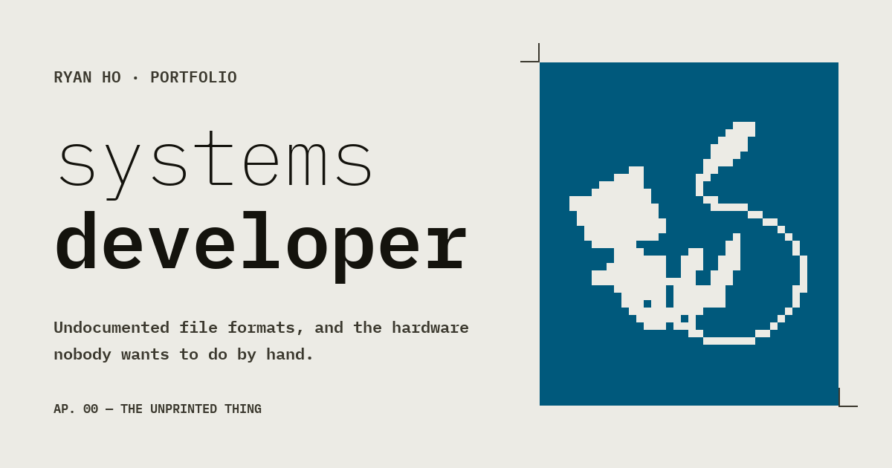

# AnimationWeb

Ryan Ho's portfolio. It is **one document, printed as a two-ink riso sky seen
through die-cut apertures**, with a procedurally animated Mew loose on the page
as the only unprinted thing on it.



Four cards — summary, experience, projects, contact — driven by the arrow keys,
with three project sheets hanging off the projects card as long documents. The
deck shape exists so the work survives being skimmed; the sheet it is cut from
has not changed.

Vite and Three.js. No framework, no CSS library, no component library. Real
routes via the History API, because Mew is a live WebGL context with physics and
a brain: a real navigation would kill her and start a new one, so the **sheet**
changes and the window does not.

## Running it

```bash
npm install
npm run dev      # localhost:5173
npm test         # 902 checks: a headless engine sim + a router/page-swap harness
npm run build    # production bundle
```

`.claude/launch.json` also carries `mew-dist`, which serves the built `dist/` —
hashed URLs, `public/`, the SPA fallback — for checking the bundle as a bundle.

## What is where

| | |
|---|---|
| `src/site/pressgl.js` | **the press.** Paper, print and every hole, in one fragment shader pass. Compiled twice from one template, once per GLSL dialect, and the two agree byte for byte. |
| `src/site/sky.js` | the same press on the CPU. The reference implementation. |
| `src/site/deck.js` | the mask: geometry, the crossing, the two draws. |
| `src/site/router.js` | going through the hole. Page scopes, generation-guarded watchdogs, the swipe. |
| `src/site/pages/sheet.js` | the two-plate trim every project sheet is cut to. The three project files are only the **words**. |
| `src/engine/**` | Mew: physics, a small brain, pose layers, and effects whose maths is headless-testable. |
| `src/mew.js` | the engine, behind a dynamic import. The sheet is a finished page without it. |
| `tools/` | the bake scripts. Nothing generated is edited by hand. |

## Reading it

Four files carry the argument, and in this order:

- **`RYAN.txt`** — the taste this was designed against. Never regenerated.
- **`STATE.md`** — what exists, the numbers, and every trap already paid for.
- **`DESIGN.md`** — what was built and why each part is there.
- **`CLAUDE.md`** — how to work in here.

Every comment in the source says *why*, and says what was tried and rejected.
That is deliberate: it is what stops the next pass redoing work that was already
measured and thrown away.

## Not finished

The three project sheets carry **placeholder prose** on the shared trim — the
plate is set and the words have not had their turn. The card media are
placeholders too. The LinkedIn handle in `src/site/content.js` is marked
`placeholder: true` and renders as visibly unset rather than as a plausible
guess.
